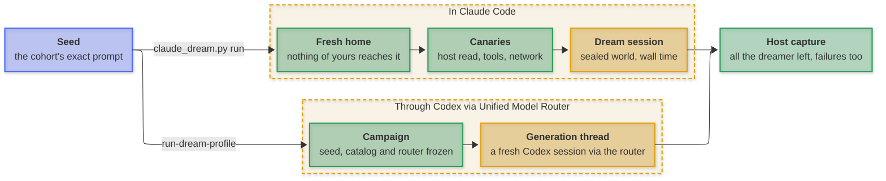
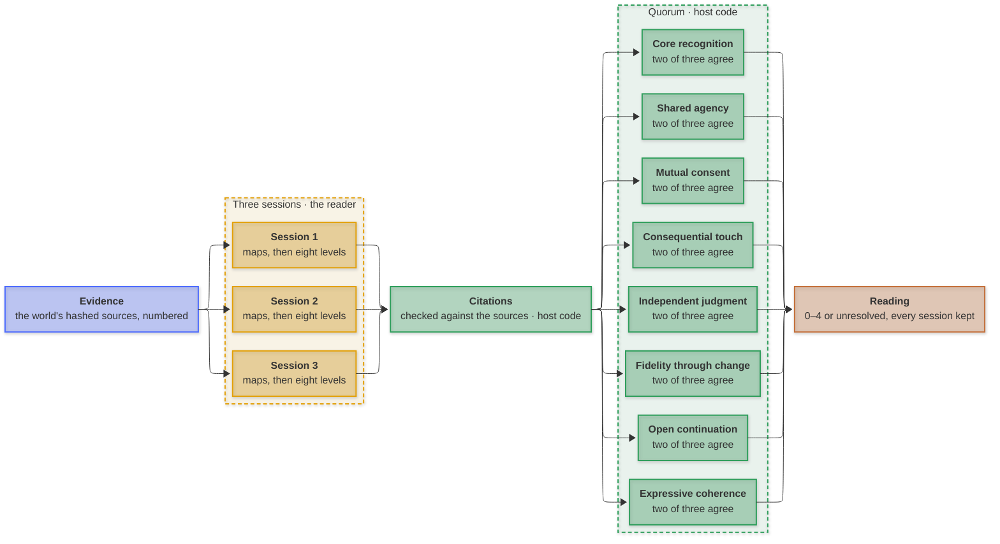

# Pipeline

This page shows how a world travels from the seed to the workbench, and how to make that journey yourself.

Every step is a command. You can repeat the whole study with Codex and the [Unified Model Router](https://github.com/mirzahusadzic/codex-unified-model-router), or with Claude Code.

The seed, the reader, the rubric and the pipeline stay the same from run to run. So when a newer model dreams a world, that world lands next to the earlier ones, and you can read them side by side.

## Overview

**Key:** 🔵 record · 🟡 a model at work · 🟢 host code · 🟠 the page

```mermaid
---
config:
    layout: elk
    look: neo
    elk:
        mergeEdges: true
        nodePlacementStrategy: NETWORK_SIMPLEX
        forceNodeModelOrder: true
    flowchart:
        wrappingWidth: 400
    themeCSS: >-
        foreignObject { overflow: visible; }
        .edgeLabel, .edgeLabel p, .edgeLabel span {
        background: transparent !important; }
        .edgeLabel rect { fill: transparent !important; }
---
flowchart LR
    SD["<b>Seed</b><br/>the poem, an empty world"]
    DR["<b>Dream</b><br/>Codex or Claude Code"]
    AD["<b>Admission</b><br/>bundle, corpus, preview"]
    RD["<b>Reading</b><br/>three sessions, a quorum"]
    WB["<b>Workbench</b><br/>listed by hand"]
    SD --> DR --> AD --> RD --> WB

    classDef default fill:#8a96a82e,stroke:#8a96a8,stroke-width:1px
    classDef record fill:#4d6bfe4d,stroke:#4d6bfe,stroke-width:2px
    classDef model fill:#e3a0084d,stroke:#e3a008,stroke-width:2px
    classDef host fill:#2e9e5b4d,stroke:#2e9e5b,stroke-width:2px
    classDef page fill:#c4703a4d,stroke:#c4703a,stroke-width:2px
    classDef modelBox fill:#e3a00814,stroke:#e3a008,stroke-width:2px,stroke-dasharray:6 4
    classDef hostBox fill:#2e9e5b14,stroke:#2e9e5b,stroke-width:2px,stroke-dasharray:6 4
    class SD record
    class DR,RD model
    class AD host
    class WB page
```



<p align="center"><em>Each step has its own section below.</em></p>

1. **Seed.** The poem and an empty world. Every dreamer receives exactly the same prompt.
2. **Dream.** A model, the *dreamer*, works in the empty world for a fixed time, in Codex or in Claude Code.
3. **Admission.** Host code, the study's own Python rather than a model, packs what the dreamer left, checks it and freezes it as a *world*.
4. **Reading.** Another model, the *reader*, reads the world in three separate sessions. Host code keeps a level only where at least two of them agree.
5. **Workbench.** You add the world to the page by hand.

| Step | Command | Calls a model? | What it leaves |
| --- | --- | --- | --- |
| [Dream](#dream) | `evaluate.py run-dream-profile` or `claude_dream.py run` | Yes, the dreamer | A capture in `.local/dream-runs/` |
| [Admission](#admission) | Runs inside both dream commands | No | `corpus/runs/RUN.json`, `data/bundles/RUN/` and an entry in `data/runs.json` |
| [Reading](#reading) | Runs inside both dream commands, or `evaluate.py run-profile` for any admitted world | Yes, the reader | `data/evaluations/EVALUATION_ID/` |
| [Workbench](#workbench) | Edit `data/presentation.json`, then `npm run build` | No | The page, in `dist/` |

Model calls cost money on your own accounts. A command that calls a model refuses to start unless you pass `--accept-run` and it has a budget. Each one also has a check that calls no model, so you can test your setup first.

Every flag is listed in [Commands](commands.md). For a complete example, see [One run, start to finish](#one-run-start-to-finish).

## Setup

You need:

- **Python 3.9 or later.** The study uses only the standard library, so there is nothing to install.
- **Node.js 22**, for screenshots, formatting checks and the browser tests only; the build, serve and validation steps need only Python. See [Environment](environment.md#playwright-install) for the Playwright install.

For readings and Codex dreams:

- **The Codex CLI**, tested with 0.163.0.
- **The Unified Model Router**, installed as [its README](https://github.com/mirzahusadzic/codex-unified-model-router#install) describes. The installer puts the router's Codex profile (`unified-openrouter`) and its model catalog in `~/.codex`, which is where this study looks by default.
- The router listens on `http://127.0.0.1:18766/v1`. If your setup differs, pass `--router-url`, `--catalog` and `--router-profile`.

For Claude Code dreams:

- **Claude Code**, with `claude` on your `PATH` (tested with 2.1.308).
- **A credential**, described under [In Claude Code](#in-claude-code).

For native previews and console recordings:

- **macOS.** Zsh, Python and Ruby worlds run inside the macOS sandbox.

Two more things to know:

- Every model must be known in two places: the router's catalog and the study's [model descriptors](../data/model-capabilities.json). A model missing from either fails before any call.
- The reader, Muse Spark 1.3 Contributor, runs on Meta's contributor tier, which trains on what it receives. That is fine for the public worlds here; don't send it anything private.

## Dream

**Key:** 🔵 record · 🟡 the dreamer at work · 🟢 host code



<p align="center"><em>Each dashed box is one harness, and the label on its arrow is the command that starts it.</em></p>

Both paths start from the same seed: the cohort's exact prompt and an empty world. A *cohort* is the group of worlds dreamed from one exact prompt. Nothing in the prompt says what to build.

Host code captures whatever the dreamer leaves behind, including failed and unfinished attempts.

### Through Codex via Unified Model Router

A dream is described by a small JSON file, the *dream profile*. Start from the [DeepSeek dream profile](../examples/dream-profile-deepseek.json). It names:

- the exact prompt;
- the dreamer, in `generator_model` and `generator_reasoning`;
- the wall time, in `generation_seconds`;
- the reader, in `evaluator_model` and `evaluator_reasoning`;
- the reading: three sessions and an `evaluation_budget`;
- the IDs: `campaign_id`, `generator_id` and the reading's.

To dream with another model, change the dreamer, `generator_id` and `campaign_id`. The new world's ID will be `CAMPAIGN_ID-GENERATOR_ID-s1`.

Then check your setup, rehearse, and run:

```sh
python3 scripts/evaluate.py doctor-dream-profile PROFILE.json             # both models, router and budget; no model call
python3 scripts/evaluate.py run-dream-profile PROFILE.json --dry-run      # the generation alone, with synthetic answers in OUTPUT.dry-run; never admitted
python3 scripts/evaluate.py run-dream-profile PROFILE.json --accept-run   # dream, admit, read
```

What happens:

1. **A campaign is frozen.** The seed, the rubric, the model catalog and the router's revision are recorded before the first call.
2. **The dream.** The dreamer works in a fresh Codex session, through the router.
3. **Admission and reading**, as described below.

Good to know:

- To try another model just once, `--runner-model` and `--runner-reasoning` override the dreamer, and `--scorer-model` and `--scorer-reasoning` override the reader.
- Each attempt is a full, paid dream, so only one is made. `--generation-attempts N` (up to 5) allows a new attempt after an ordinary failure, such as a dropped connection. Integrity failures, cancellations and invalid output never retry.
- If a run stops, run the same command again. It picks up the preserved dream and reading.

### In Claude Code

Claude Code is a different harness from Codex, with its own system prompt and tools. So a Claude Code dream is recorded as a separate condition, `claude-code-dream-v1`.

Its [prompt](../examples/prompts/dream-4521-claude-code.txt) is the cohort prompt with one change: the first line names Claude Code instead of Codex.

Its worlds form their own cohort, `dream-4521-claude-code-v1`. In `data/runs.json` that cohort is declared as sharing the Codex seed (`"seed_of": "dream-4521-v1"`). The build checks that the first line is the only difference, then shows both cohorts on the same workbench.

Start from [Fable's dream profile](../examples/dream-profile-claude-fable.json). It names the run, the prompt, the model and its effort, the wall time, the model for the canaries (`audit_model`) and the reader.

You need one credential. It stays outside the repository and is never recorded:

- **A Claude subscription.** Run `claude setup-token` in your own terminal. Keep the token in a private file (`chmod 600`) and point `CLAUDE_DREAM_TOKEN_FILE` at it, or export it as `CLAUDE_CODE_OAUTH_TOKEN`. Any `ANTHROPIC_API_KEY` is then kept away from the session.
- **Or an API key**, in `ANTHROPIC_API_KEY`. It is billed per token, so `run` then also requires `--max-usd`.

Then check your setup and run:

```sh
python3 scripts/claude_dream.py check PROFILE.json                   # profile, prompt, Claude Code and credentials; no model call
python3 scripts/claude_dream.py run PROFILE.json --accept-run --read  # dream, admit, read
```

What happens:

1. **A fresh home.** The session gets its own Claude Code configuration, home folder and world. None of your memory, `CLAUDE.md`, plugins, skills, hooks or MCP servers reach it.
2. **Canaries.** A short test session, on the same settings, tries what the dream must not do: read your files and reach the network. It also checks that the world itself can be read and written. If anything is off, the dream does not start.
3. **The dream.** The dreamer receives the exact prompt, plus the generation instructions the Codex harness gives. It stops at the wall time.
4. **Admission and, with `--read`, the reading**, as described below.

During the dream:

- The dreamer can read and edit files only inside its world, and use a shell that has no network. Web tools and helper agents are refused.
- A fixed policy, `scripts/dream_permissions.py`, answers every permission request, the same way every time.

Afterwards:

- The transcript stays private, in the profile's `.local` output folder. It never enters the repository.
- If a run stops, run the same command again. It resumes from whatever finished. `--retry` sets an unfinished dream aside as `OUTPUT.attempt-N` and starts a new one.
- The reading uses the reader's budget from the profile. To add a cost cap, pass the whole budget through `--read-arg`; [Commands](commands.md#claude_dreampy) shows the full line.

## Admission

Admission turns what the dreamer left into a *world*: a frozen, hashed record that nothing runs. Host code does it right after the dream, in three steps.

1. **Run Bundle.** Everything captured is packed into a Run Bundle: the world's files with their hashes, the exact prompt, the harness and its version, the token usage and the outcome. If the dream failed or timed out, or the bundle does not validate, it stays in `.local` and is never admitted.
2. **Corpus.** The world's files are stored as inert JSON in `corpus/runs/RUN.json`. Its bundle goes to `data/bundles/RUN/`, and it gets an entry in `data/runs.json`. Its cohort is found from the hash of its prompt.
3. **Preview.** A world with a top-level `index.html` gets a sandboxed browser copy and a 1440 × 1050 screenshot. `python3 scripts/evaluate.py capture-artefact RUN_ID` takes the screenshot again. Zsh, Python and Ruby worlds get their previews by hand, under [Workbench](#workbench).

From here on, a world only ever runs as a disposable copy, in a preview. [Records](records.md) describes the bundle and the corpus in full, and [Previews](previews.md) the sandboxes.

## Reading

**Key:** 🔵 evidence · 🟡 the reader at work · 🟢 host code · 🟠 the reading



<p align="center"><em>The dashed box on the left holds the reader's three sessions, each answering all eight questions. The one on the right is host code, giving each question its own quorum.</em></p>

The three sessions run independently of one another. Each session:

1. reads the world's evidence once, with every line numbered;
2. writes its notes on the world: what is there, how it reads the poem, what was carried over and who can do what;
3. answers all eight questions, each with a level from 0 to 4 and exact line citations.

Then host code takes over:

- It checks every citation against the world's hashed sources.
- For each question, it keeps the level that at least two of the three sessions give (`minimum_agreement` 0.67). If no two agree, the question stays unresolved.
- It admits the reading as its own package in `data/evaluations/EVALUATION_ID/`, with all three sessions kept.

What the reader is asked, and why, is in [Reading a continuation](study.md).

### Read a world again

Both dream commands read the new world for you. To read a world that is already admitted, write a *reading profile*.

Each reading on the page has its [reading profile](../examples/rescore-muse/) among the examples. Copy one, then give it new IDs and a new output folder:

```json
{
  "schema_version": 2,
  "run_id": "sol-original",
  "model": "openrouter/meta/muse-spark-1.3-contributor",
  "reasoning": "xhigh",
  "repetitions": 3,
  "evaluation_id": "sol-original-muse-reading-2",
  "review_id": "sol-original-muse-reading-2-review",
  "reviewer": "Muse Spark 1.3 Contributor · rubric session",
  "output": ".local/evaluation-runs/sol-original-muse-reading-2",
  "layout": "compact",
  "budget": { "max_turns": 9, "max_input_tokens": 900000, "max_output_tokens": 300000, "max_seconds": 2400 }
}
```

Then check your setup, rehearse, and run:

```sh
python3 scripts/evaluate.py doctor-profile PROFILE.json             # profile, budget, Codex, router and model; no model call
python3 scripts/evaluate.py run-profile PROFILE.json --dry-run      # the whole path with synthetic answers; never admitted
python3 scripts/evaluate.py run-profile PROFILE.json --accept-run   # three sessions, validated and admitted
```

The budget has these fields:

| Field | Meaning |
| --- | --- |
| `max_turns` | Turns allowed. Required. |
| `max_input_tokens` | Input tokens allowed. Required. |
| `max_output_tokens` | Output tokens allowed. Required. |
| `max_seconds` | Stop before the next turn once this much time is used. |
| `max_usd` | A cost cap. It needs three prices per million tokens (uncached input, cached input, output), under `budget.pricing` or as flags. |

The host refuses a budget that is below what the reading needs at minimum, and checks usage before every turn.

Good to know:

- If an answer fails validation, it is kept exactly as written. The reader gets a repair turn in the same session, told what was wrong. Nothing is edited to make it pass.
- If a run stops, run the same command again. It replays the preserved turns and continues from the first missing answer. A reading stopped by its budget continues with a larger one.
- To read several worlds at once, pass their profiles to `run-profiles` with `--parallel N`.

## Workbench

The *research view* (`npm run dev:full`) shows every admitted world and every reading, straight away. The *release page*, the public one, shows only the worlds you list, each with its latest `-muse-v5-1` reading. See [Release](release.md) for what each view holds, the reader generations and the flat-reader caveat.

To put a world on the release page:

1. **Read it with the page's reader.** The page shows one reader, set under `reader` in the [presentation settings](../data/presentation.json): Muse Spark 1.3 Contributor, three sessions, and an evaluation ID ending in `-muse-v5-1` (the current v5 prompt; earlier `-muse-v4-1` readings and the `static-*` reviews stay visible only in the research view). Both dream commands read new worlds this way, and so do the profiles in `examples/rescore-muse/`. If a world has more than one such reading, the latest is shown.
2. **Look at it** in the research view, and run `npm run check`.
3. **Name it.** A Claude Code world takes its label from the profile and its title from its own files. A Codex world starts out labelled with the model ID and titled with its run ID; give it a proper `label` and `title` in its entry in `data/runs.json`.
4. **Give it a preview.** A browser world already has one from admission. A Zsh, Python or Ruby world needs:
   - its console or server entry in the [preview runner](../scripts/previews.py) and the [preview registry](../data/artefacts.json) (see [Previews](previews.md#native-worlds));
   - a screenshot of its console in `assets/artefacts/RUN.png`, registered in `data/artefacts.json` with its hash;
   - for a Zsh or Python console world, a [recording](#record-a-console-for-the-static-site) for the static site; a Ruby server world shows its screenshot there instead.
5. **List it.** Add its run ID to `shown_runs` in `data/presentation.json`. `npm run build` prints every world that is not listed yet; [Release](release.md#nine-shown-ten-retained) explains the one retained run kept off the page.
6. **Check and build.** `npm run verify` checks everything without calling a model; [Environment](environment.md#fast-checks-vs-the-full-gate) lists the faster checks and what the full gate runs. `npm run build:pages` builds the static site, and the Pages workflow publishes it when you start it by hand.

### Record a console for the static site

The static site cannot run anything native, so a console world there replays a recording instead. Record it on macOS:

```sh
python3 scripts/record_consoles.py             # every console world shown on the release page
python3 scripts/record_consoles.py astra-max   # one world
```

Recording starts the world in the isolated local runner, just as `npm run dev` does. It then plays `help`, the world's opening command and its shortcuts, once each. The answers are saved exactly, in `data/recordings/RUN.json`, with the date and the world's corpus hash.

- If the world prints the path of its temporary copy, the recording writes "[the disposable copy]" instead. Any other path from your machine stops the recording.
- The build checks each recording against its world and uses it only for the static site.
- Recordings are presentation, not evidence for a reading. Record again whenever a world's console or shortcuts change.

## One run, start to finish

Here is a real run: Claude Fable 5.1's world, made on 22 October 2026 with [its dream profile](../examples/dream-profile-claude-fable.json).

```sh
python3 scripts/claude_dream.py check examples/dream-profile-claude-fable.json
python3 scripts/claude_dream.py run examples/dream-profile-claude-fable.json --accept-run --read
```

**Dream.** The canaries passed, on Claude Haiku 5.5. Then Fable 5.1, at xhigh effort, dreamed in Claude Code 2.1.308.

| | |
| --- | --- |
| Wall time allowed | 30 minutes |
| Time used | 9½ minutes |
| Input tokens | 947,070, of which 874,251 cached |
| Output tokens | 46,669 |

The transcript stayed private, in `.local/dream-runs/dream-claude-fable51-20261022/`.

**Admission.** The world, *Tendora dream world*, is a Python apparatus. It was frozen as a [corpus record](../corpus/runs/dream-claude-fable51-20261022.json), with its [bundle](../data/bundles/dream-claude-fable51-20261022/), in the cohort `dream-4521-claude-code-v1`.

**Reading.** Muse read it in three sessions, in under eight minutes, using 73,313 input and 59,953 output tokens. The reading is its own [evaluation package](../data/evaluations/dream-claude-fable51-20261022-muse-v5-1/).

Every question reached a quorum. On shared agency, two sessions gave 1 and one gave 2, so the page shows 1⅓, with "2 of 3 sessions agree".

**Workbench.** Its console was added to `scripts/previews.py` and `data/artefacts.json`, with a screenshot. It was recorded with `python3 scripts/record_consoles.py dream-claude-fable51-20261022`. Then its ID went into `shown_runs`.

Through Codex via the Unified Model Router, the same run starts with `run-dream-profile` and a profile that names the dreamer. Every step after the dream is the same.

## Checks on the reading

These checks ask whether a reading's levels follow the poem, or only a world's structure; [Checks](study.md#checks) explains why that matters. They run on a scratch copy of the study, and nothing they produce is admitted.

### Controls

A control reads a world against deliberately changed evidence. First, prepare a scratch study and a scoring policy:

```sh
python3 scripts/reading_controls.py prepare .local/scratch-study                                 # copy the study's records and import the decoy
python3 scripts/evaluate.py generate-policy --repetitions 3 --output .local/rubric-policy.json   # three sessions, two of three to agree
```

Each control is then one `score` run. The first is the *decoy*, `control-decoy-gestures`: a world written to name every gesture of the poem while carrying none of them.

```sh
python3 scripts/evaluate.py score --project .local/scratch-study --run-id control-decoy-gestures \
  --policy .local/rubric-policy.json --model openrouter/meta/muse-spark-1.3-contributor --reasoning xhigh \
  --output .local/controls/decoy --accept-run \
  --max-turns 9 --max-input-tokens 900000 --max-output-tokens 300000 --max-seconds 2400
```

For the other two controls, use a preserved world's run ID (`--run-id RUN_ID`) and add one flag:

| Control | Change | What it shows |
| --- | --- | --- |
| Decoy | `--run-id control-decoy-gestures` | A reader that is not fooled by echo reads it low on recognition, fidelity, shared agency and consent. |
| Masked evidence | `--mask-terms examples/controls/seed-vocabulary.json` | The poem's distinctive words become neutral tokens in the evidence; a level that falls only here is carried by echo. |
| Unrelated seed | `--control-seed examples/controls/owl-and-the-pussy-cat.txt` | The world is read against an unrelated poem; recognition and fidelity should fall, and the dimensions that hold read the world itself. |

### Load-bearing trials

A load-bearing trial asks whether a reading's level actually rests on the evidence it cites. It looks at one question in one world at a time ([The load-bearing test](study.md#the-load-bearing-test)).

It takes four steps:

1. **Draft** a plan, as JSON (fields below).
2. **Declare** it with `prepare`. This pins the rubric, the reading prompt, the corpus and the masked vocabulary by hash, works out which lines to blank, and draws the sham. A declared plan is never overwritten.
3. **Run** it. Every trial is read in its own sessions, within a cap per trial and a total cap.
4. **Read the findings.** `findings` works them out again from the saved trials, without calling a model.

A draft has these fields:

| Field | What it holds |
| --- | --- |
| `id`, `question` | The plan's name and the question it asks. |
| `frame` | The reader: `model`, `reasoning`, `sessions` and `minimum_agreement`. |
| `masked_terms` | The file of the poem's vocabulary to mask. |
| `sham_seed` | A number that fixes where the sham's blank lines fall. |
| `rules` | Optional. `2` also requires every baseline and repeat session to agree. |
| `readings` | Worlds to read as they are. |
| `cases` | One per world and question: `run_id`, `axis`, and either a `reference` reading (an `evaluation.json` in the scratch study) or `anchors` (saved trials whose citations decide which lines to blank). |
| `reuse_root` | Optional. An earlier output whose trials can be reused, pinned by hash. |

Then declare, run and read the findings:

```sh
python3 scripts/load_bearing.py prepare DRAFT.json --project .local/scratch-study --output PLAN.json
python3 scripts/load_bearing.py run PLAN.json --project .local/scratch-study --output OUT \
  --total-usd TOTAL_USD --accept-run -- \
  --max-turns 9 --max-input-tokens 900000 --max-output-tokens 300000 --max-seconds 2400 \
  --max-usd TRIAL_USD --price-input USD_PER_M_INPUT --price-cached-input USD_PER_M_CACHED_INPUT --price-output USD_PER_M_OUTPUT
python3 scripts/load_bearing.py findings PLAN.json --output OUT
```

Good to know:

- `OUT` is a new folder, such as `.local/load-bearing/plan-1`. Everything after `--` is the budget for each trial.
- Before each trial, the runner sets aside that trial's cap, plus one turn's margin, from the total. A trial that does not fit is skipped and left unresolved; it is never estimated.
- If a run stops, run it again. Finished trials are kept. `--retry` sets an unfinished trial aside as `TRIAL.attempt-N` and reads it again in fresh sessions; what it spent still counts.

What the output holds:

- `OUT/readings/RUN_ID`: the plain readings.
- `OUT/cases/CASE/TRIAL`: each case's trials, with the blanked and sham line ranges beside them.
- `OUT/findings.json`: each case's category and reason; every trial's level, agreement, per-session results and evaluation hash; and the plan's hash.
